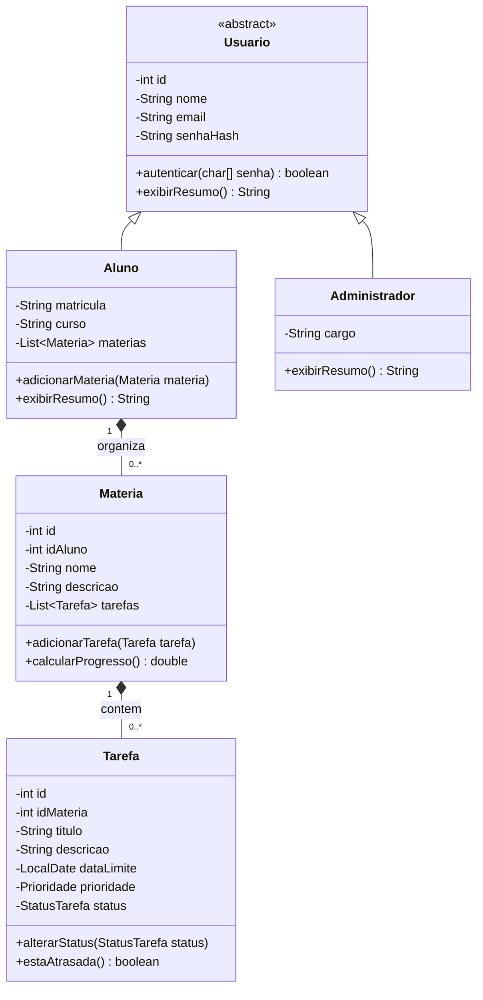
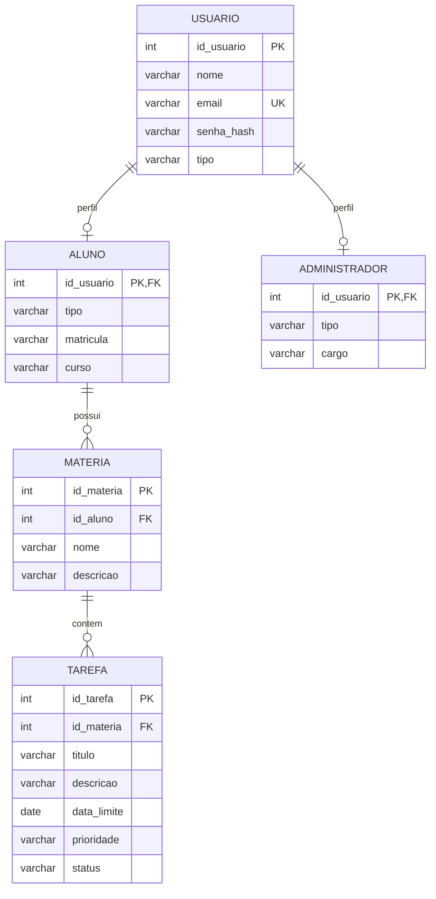

# Diagramas da implementação

O GitHub renderiza os blocos Mermaid deste arquivo. Os diagramas mostram o domínio e os vínculos do banco; as camadas DAO, service, view e util permanecem separadas.

## Classes de domínio

`Prioridade`: BAIXA, MEDIA, ALTA. `StatusTarefa`: PENDENTE, EM_ANDAMENTO, CONCLUIDA.

## Banco PostgreSQL — esquema educaplan

O código grava usuário e subclasse na mesma transação. As FKs compostas `(id_usuario, tipo)` e os `CHECK`s nas subclasses impedem perfil incompatível. Cada usuário criado pela aplicação possui um único perfil. A exclusão em cascata preserva o ciclo de vida das composições.
