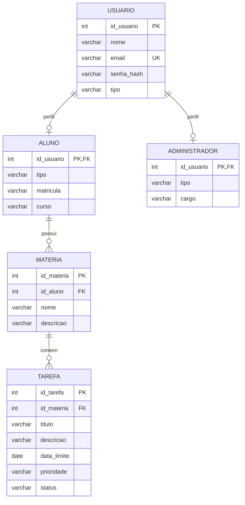

# Esquema do banco de dados do EducaPlan

O EducaPlan usa PostgreSQL no Supabase. O script [database/educaplan.sql](../database/educaplan.sql) cria o esquema `educaplan`, as cinco tabelas e seus vínculos. Execute o script no SQL Editor ao preparar um banco novo para o projeto.

| Tabela | O que armazena | Vínculo |
| --- | --- | --- |
| `usuario` | Nome, e-mail, hash da senha e tipo de perfil. | O ID identifica o usuário nas tabelas de perfil. |
| `aluno` | Matrícula e curso. | `id_usuario` referencia o usuário do tipo aluno. |
| `administrador` | Cargo. | `id_usuario` referencia o usuário do tipo administrador. |
| `materia` | Nome e descrição de uma matéria. | `id_aluno` identifica seu aluno responsável. |
| `tarefa` | Título, descrição, prazo, prioridade e status. | `id_materia` identifica a matéria vinculada. |

Um aluno pode ter várias matérias. Cada matéria pode ter várias tarefas. As chaves estrangeiras garantem esses vínculos. A exclusão de uma matéria remove suas tarefas em cascata.

